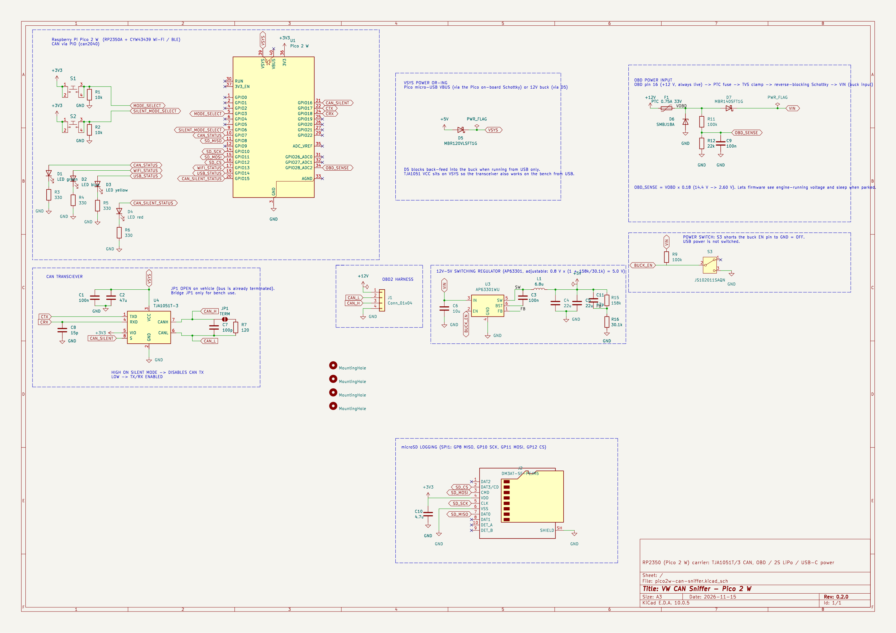
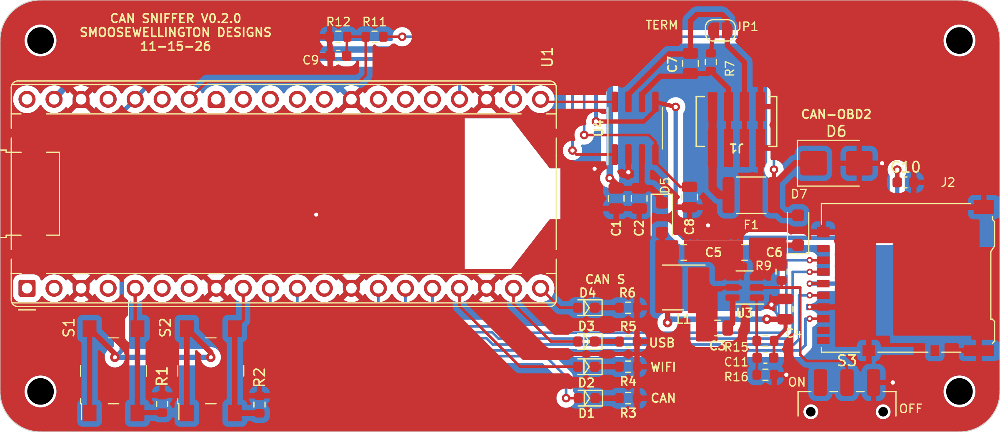
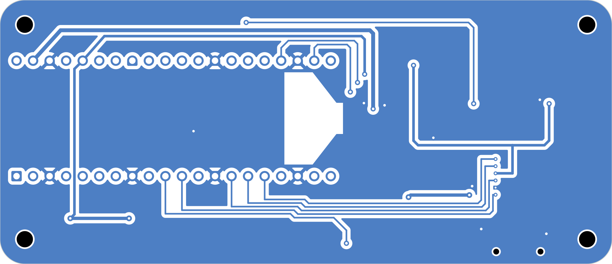
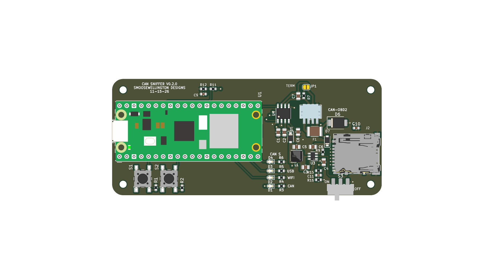
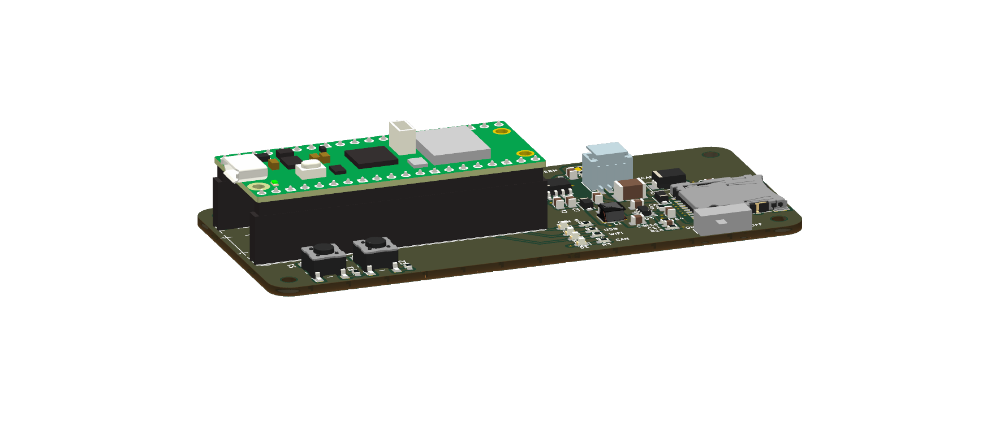

# Pico 2 W CAN Sniffer PCB — v0.2.0 (bench / development board)

Goal: a home-built VW diagnostic interface (UDS over the OBD port) driven from an iOS app over Bluetooth LE, with
logging. This board is the development unit; a low-profile OBD dongle on RP2350 is planned as v0.3.0.

Single-MCU carrier for a **Raspberry Pi Pico 2 W** (RP2350A + CYW43439 Wi-Fi/BLE). It replaces the
Teensy 4.0 + XIAO ESP32S3 pair used on [v0.1.0](../../../teensy-esp32/README.md)
(git tag `v0.1.0`).

> The RP2350 chip itself has no radio. Wi-Fi/BT comes from the CYW43439 on the Pico 2 W module, so this
> board carries the module (socketed on two 1×20 headers) rather than a bare RP2350.







## What changed from v0.1.0
- U1 Teensy 4.0 and U2 XIAO ESP32S3 removed; U1 is now the Pico 2 W. The Teensy↔ESP32 UART link is gone.
- CAN controller: RP2350 has no CAN peripheral, so CAN runs in PIO ([can2040](https://github.com/KevinOConnor/can2040))
  straight into the existing TJA1051T/3.
- **D5** (MBR120VLSFT1G Schottky) between the 5 V buck and VSYS, so USB and the 12 V buck can be plugged in
  together without back-feeding the buck. TJA1051 VCC moved to VSYS so the transceiver also works from USB alone.
- **JP1** solder jumper in series with the 120 Ω terminator R7, **open by default**. Leave it open on the car
  (the bus is already terminated); bridge it only on the bench.
- Power comes from a protected OBD 12 V feed or the Pico's own micro-USB (see Power below). **S3** is the on/off
  switch for the OBD-powered buck.
- **microSD socket (J2)** on SPI1 for standalone logging.
- OBD supply voltage is measured on GP28 so firmware can tell engine-running from parked.
- Board is now 93.98 × 40.64 mm (v0.1.0 was 68.58 mm wide): +7.62 mm to keep the CAN/power section out from
  under the Pico antenna and +17.78 mm for the power-input and microSD section. Left mounting holes are unchanged;
  the right pair moved +25.4 mm. The CAN transceiver and buck layout are carried over from v0.1.0.
- Antenna end of the Pico has a copper/track keep-out on both layers.

## Pin map
| Pico pin | GPIO | Net | Function |
|---|---|---|---|
| 5  | GP3  | `MODE_SELECT`        | S1 mode button (active-high, 10 k pull-down) |
| 9  | GP6  | `SILENT_MODE_SELECT` | S2 silent-mode button (active-high, 10 k pull-down) |
| 10 | GP7  | `CAN_STATUS`         | D1 CAN activity LED |
| 11 | GP8  | `SD_MISO`            | microSD DAT0 (SPI1 RX) |
| 14 | GP10 | `SD_SCK`             | microSD CLK (SPI1 SCK) |
| 15 | GP11 | `SD_MOSI`            | microSD CMD (SPI1 TX) |
| 16 | GP12 | `SD_CS`              | microSD DAT3/CS |
| 17 | GP13 | `WIFI_STATUS`        | D2 Wi-Fi LED |
| 19 | GP14 | `USB_STATUS`         | D3 USB LED |
| 20 | GP15 | `CAN_SILENT_STATUS`  | D4 silent-mode LED |
| 21 | GP16 | `CAN_SILENT`         | TJA1051 `S` (high = listen-only) |
| 22 | GP17 | `CTX`                | TJA1051 `TXD` |
| 24 | GP18 | `CRX`                | TJA1051 `RXD` |
| 34 | GP28 | `OBD_SENSE`          | OBD supply voltage, ADC2. V_obd = V_adc × 5.545 |
| 36 | —    | `+3V3`               | 3V3 out → TJA1051 VIO, buttons, microSD |
| 39 | —    | `VSYS`               | 5 V in via D5 (buck); also TJA1051 VCC |

All other GPIO are unconnected. Matching firmware header: [`../../firmware/pins.h`](../../firmware/pins.h).

## Power
```
OBD +12V ─ F1 (PTC) ─┬─ D7 ─ VIN ─ AP63301 buck ─ +5V ─ D5 ─┬─ VSYS ─ Pico 3V3 reg ─ +3V3
                     D6 (TVS)            Pico micro-USB ────┘ (Pico on-board diode)
```
- **OBD:** J1 pin 1 → 0.75 A PTC → SMBJ18A clamp → Schottky blocking diode. Harness: J1 pin 1 = +12V
  (OBD pin 16), pin 2 = CAN_L (OBD 14), pin 3 = CAN_H (OBD 6), pin 4 = GND (OBD 4 and 5).
- **Power switch (S3):** shorts the buck enable pin to ground. OBD pin 16 is always live and the board draws
  roughly 50–100 mA while running, so switch off or unplug when parked until firmware sleep exists.
- **OBD sense:** fused OBD voltage → 100 k / 22 k → GP28. About 12.0–12.8 V parked, 13.5–14.5 V with the engine running.
- **USB:** the Pico's micro-USB powers the board and carries data and firmware loading. It is not switched by S3.
  The separate USB-C power socket from an earlier pass was removed as redundant.
- **Regulator:** AP63301WU-7, adjustable, set to 5.0 V by R15/R16 (158 k / 30.1 k) with a 47 pF feed-forward
  capacitor and a 6.8 µH inductor, per the datasheet's 5 V table. It replaced the fixed-5 V AP63205, which was out of
  stock. The AP63301 runs fixed-frequency PWM at all loads, so it draws a few mA more at light load than the
  AP63205 did; the pin-compatible AP63300 (PFM) is the lower-idle-current option when it is available.
- VSYS is about 4.7 V on any source (TJA1051 VCC minimum is 4.5 V).
- There is no battery input; the earlier 2S LiPo circuit was removed.

## microSD
Hirose DM3AT push-push socket on the right edge, wired for SPI mode on SPI1 with a 4.7 µF supply capacitor.
DAT1/DAT2 and the card-detect switch are not connected, and there is no pull-up on CS (firmware should drive CS
high before touching the bus). No battery-backed clock: timestamps come from the phone at connect, or count
from power-on.

## Verification status
- ERC: 0 errors (remaining warnings are missing third-party libraries, same as v0.1.0).
- DRC: 0 unconnected, 0 clearance/short/courtyard errors. Remaining: Pico USB-connector silkscreen overhanging the
  board edge (intentional) and the J1 reference over its own pads (cosmetic).
- `kicad-cli` schematic-parity reports 34 "No corresponding pin found" warnings on auto-named nets
  (`Net-(…)`, `unconnected-(…)`). Pad nets were assigned directly from the schematic netlist; run
  *Tools → Update PCB from Schematic* once in the GUI to refresh pad metadata.
- The power-input and microSD sections and the regulator's feedback divider are new and unbuilt.
- The SD fan-out uses 0.6 mm / 0.3 mm vias; check your fab's minimum before ordering.
- F1 is specified by rating only (0.75 A hold, ≥30 V, 1812); pick an in-stock part before ordering.
- 3D models: J1 uses the Molex STEP file in [`../3dmodels/`](../3dmodels/README.md). S3 (slide switch) uses a
  placeholder box whose heights are assumed, not from the datasheet. F1 uses a same-size 1812 capacitor model as a stand-in.
- Not yet done: fab outputs (gerbers), bring-up on hardware.

## BOM and fab files
- [`../bom/bom.csv`](../bom/bom.csv): purchase BOM with manufacturer and DigiKey part numbers, and the DigiKey
  stock seen on 2026-11-15.
- [`../bom/digikey-cart-1-board.csv`](../bom/digikey-cart-1-board.csv): the in-stock lines in DigiKey's cart-upload
  format, quantities for one board.
- [`../bom/prototype-kit.csv`](../bom/prototype-kit.csv): everything else needed to build and test one
  prototype that is not soldered to the board: OBD plug, harness parts, cables, bench equipment, PCB fabrication.
- [`../fab/`](../fab/): gerbers and drill files (also zipped) and a placement file.

Every line was in stock at DigiKey on 2026-11-15. Three have thin stock:
- **U1, Pico 2 W:** Raspberry Pi's own listing (SC1633) showed 0. The BOM uses the Olimex-sold Pico 2 W
  (RP2350-PICO2-W), which had only 2 in stock and comes without headers, so pin headers are added.
- **U3, AP63301WU-7:** 156 in stock. The automotive AP63301QWU-7 (815 in stock) is a drop-in.
- **L1, 74404042068:** 88 in stock.

Stock moves quickly; re-check before ordering.

The J1 mating plug and crimp contacts are in the BOM and the cart file. The OBD plug and the other off-board
items in `prototype-kit.csv` are mostly generic parts suggested for Amazon; Amazon refuses automated access, so
those lines are search terms, not checked listings. The rows marked as checked were seen at the named seller.
