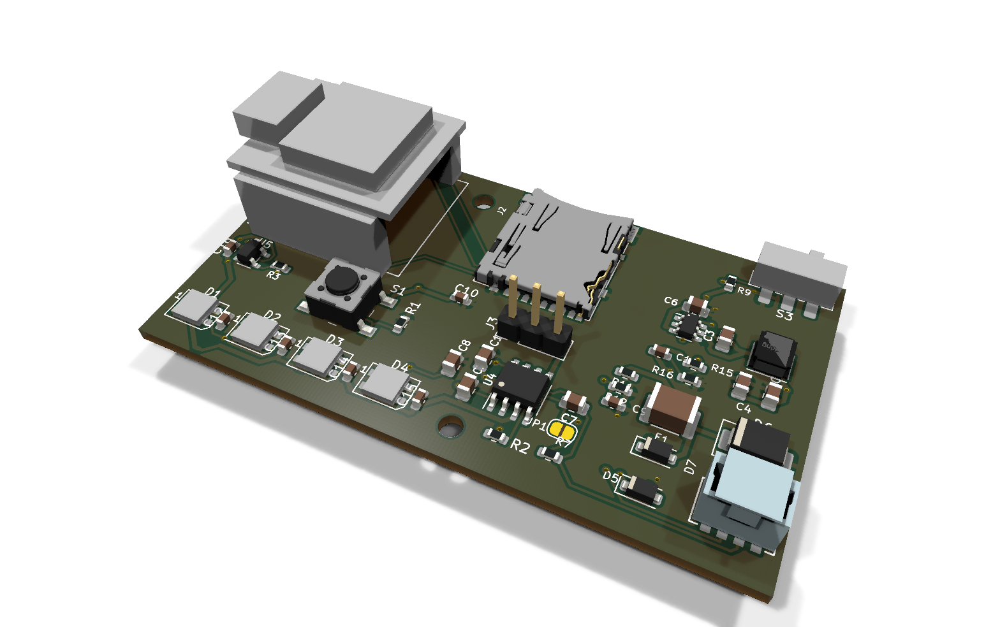

# VW CAN sniffer, XIAO ESP32-S3 carrier (v0.3.0)

Carrier board for a **Seeed XIAO ESP32-S3**: CAN through the chip's own TWAI controller and a TJA1051T/3
transceiver, power from the OBD port or the module's USB-C, and a microSD socket for logging. It does the same
job as the [Pico 2 W board](../../../pico2w/README.md) (v0.2.0) with a module that is far easier to buy, and both
run the same firmware core, protocol and tools.

**This board has not been fabricated.** It is routed and DRC clean; see "State" below for what is unverified.



## Why this board exists
The Pico 2 W was down to two in stock at DigiKey when the v0.2.0 BOM was built. The XIAO ESP32-S3 is widely
stocked, and it suits the project better in two ways: CAN is a hardware peripheral rather than software
bit-banging in PIO, and Bluetooth LE is part of the main chip. See [`../../docs/design_notes.md`](../../docs/design_notes.md)
for the decisions and the pin map.

## What is on the board
- **U1** XIAO ESP32-S3 on 2.54 mm headers (sockets, or soldered flat).
- **U4** TJA1051T/3 CAN transceiver, 5 V supply with a 3.3 V VIO pin, with **R2** holding it in listen-only
  until firmware says otherwise.
- **J1** 4-pin Molex Pico-SPOX for the OBD harness: +12 V, CAN high, CAN low, ground.
- **Power**: OBD +12 V through a PTC fuse, a TVS clamp and a blocking Schottky into an AP63301 buck at 5 V,
  then a second Schottky into the module's 5V pad. **S3** switches the buck off so the board can stay plugged in.
- **J2** microSD socket on SPI for logging.
- **D1 to D4**, four addressable RGB LEDs in one chain (status, CAN, Bluetooth, logging), with a buffer.
- **S1** a button, **J3** a spare pin on a header, and the OBD voltage divider on **D10**.

The power path, transceiver, harness connector and card socket are the v0.2.0 circuits, which were simulated
and sourced.

## Layout
68 x 38 mm, two layers. The module's USB-C and the microSD slot face the top and left edges, the power switch's
actuator sticks out of the top edge, the harness connector is at the bottom right, and the four LEDs run along
the bottom edge. Two M2.5 holes, diagonally opposite.

## State
| Piece | State |
|---|---|
| Schematic | Complete, ERC clean |
| PCB | Placed, autorouted (Freerouting), ground poured, **DRC: 0 errors, 0 unconnected** |
| Fabrication files | `../fab/`: gerbers, drill, placement file, and a STEP model for the enclosure |
| BOM | `../bom/bom.csv`. Stock-checked except the module, LEDs, buffer, header and sockets |
| Footprint for the module | From Seeed's published dimensions; check against a real module before ordering |

Nothing has been built or tested. Before ordering: check the unverified BOM lines, check the module footprint
against a module, and review the buck converter's layout (it was autorouted).

Remaining DRC warnings are cosmetic: silkscreen text over pads (clipped by the fab), and footprints that differ
from KiCad's current library versions.

## Regenerating
The schematic and the board are both built by scripts in [`../scripts/`](../scripts/build.sh): the schematic is
derived from the Pico board's, then the board is placed from the netlist, routed by Freerouting, poured and
checked. Rebuilding gives an identical schematic and a routed, DRC-clean board.

```bash
hardware/xiao-esp32s3/pcb/scripts/build.sh            # everything
hardware/xiao-esp32s3/pcb/scripts/build.sh --board    # keep the schematic, redo placement and routing
```

Hand edits in KiCad are fine too, but a rebuild overwrites them; move a change into the scripts if it should
survive.
